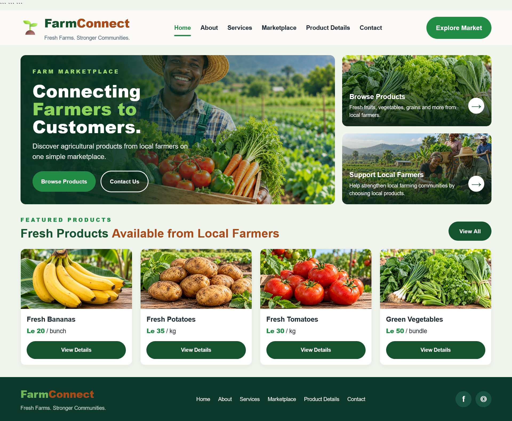
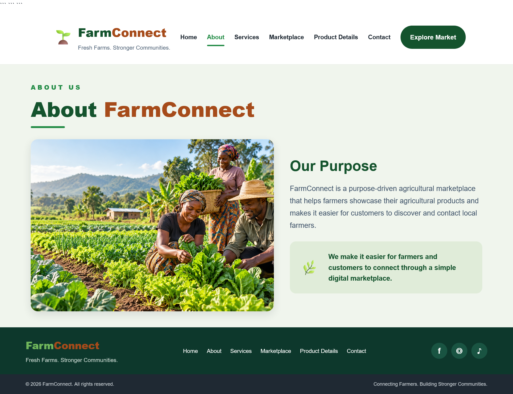
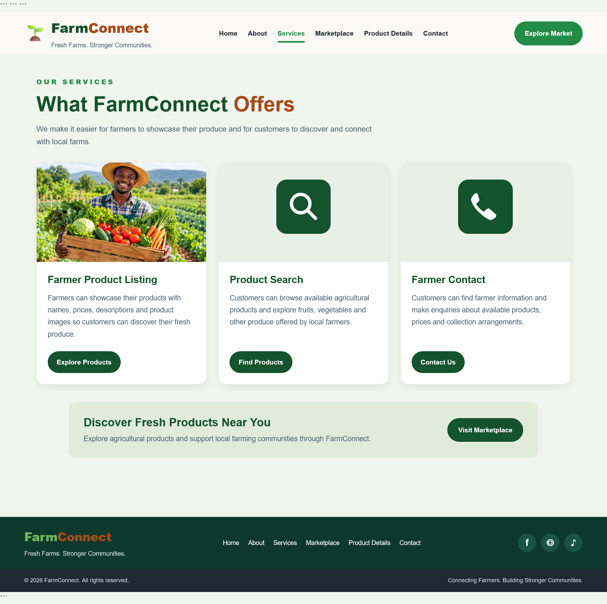
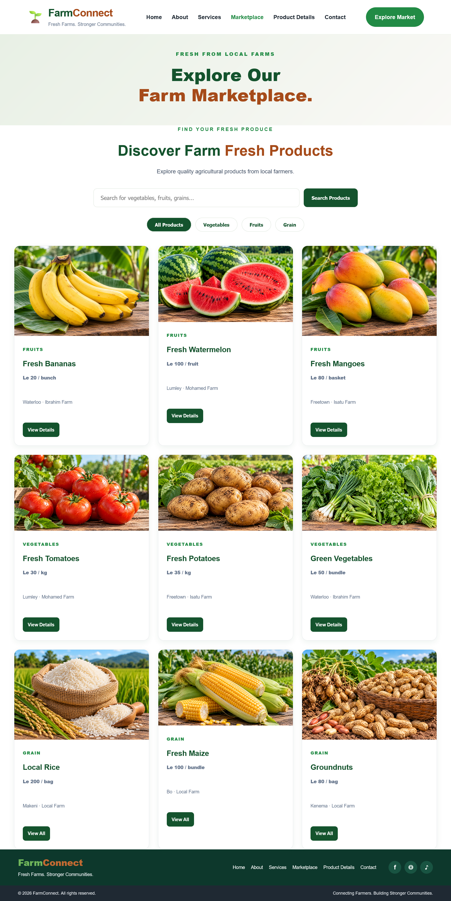
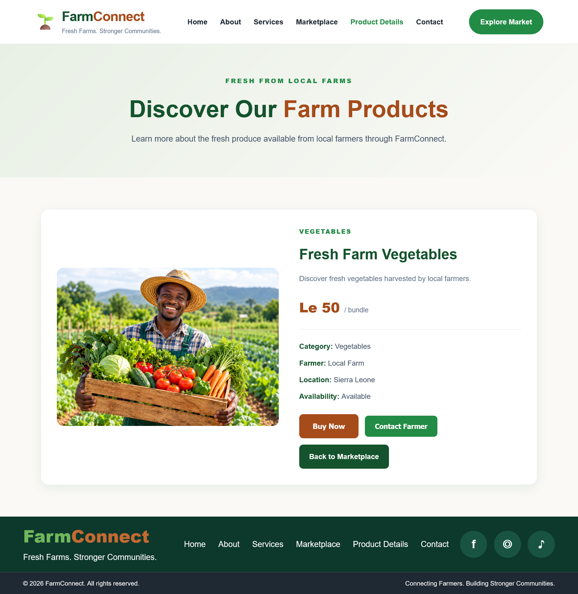
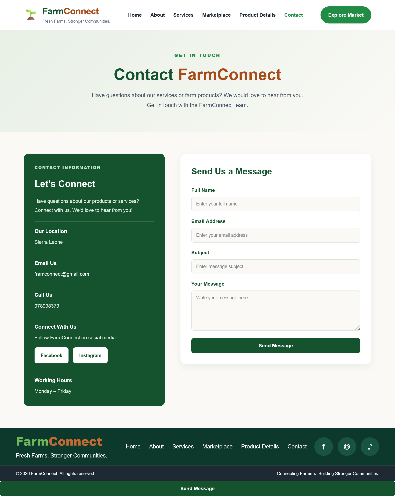

# FarmConnect

FarmConnect is a front-end agricultural marketplace website designed to help customers discover agricultural products offered by local farmers in Sierra Leone.
is a proposed online marketplace that connects farmers with customers, making it easier for farmers to showcase and sell their agricultural products while allowing customers to discover available farm products.


## Project Overview

FarmConnect presents a simple online space where visitors can browse farm products, learn about the project, explore the services offered, and find ways to contact farmers.Many customers want to find fresh agricultural products, while local farmers need ways to make their products and prices visible to potential buyers. FarmConnect is designed as a simple website that brings product information together in one place.

Visitors can explore the website to learn about FarmConnect, read about its services, browse products such as fruits, vegetables, and grains, and view details such as product prices, categories, farmer names, and locations. The site also provides contact options and demonstration forms to show how customers could express interest in a product or prepare a message for a farmer.

The website is built with HTML, CSS, and JavaScript. It is a front-end demonstration project: the forms do not connect to a live database, store orders, or send messages to farmers. The project demonstrates the structure, visual design, navigation, and basic interactions of an agricultural marketplace website.

## Problem Statement

Customers may find it difficult to discover what local farmers are selling, while farmers may have limited ways to present their products to a wider group of customers. When product information is scattered, it can take extra effort for customers to find prices, product availability, and farmer contact details.

## Proposed Solution

FarmConnect provides a central website where customers can browse agricultural products and view key product information. Separate pages explain the purpose of the platform, describe its services, provide product details, and offer contact information. Search and category filters help visitors narrow down the products they want to explore.


## Target Users

FarmConnect is designed for the following groups:

Farmers
Farmers will use the platform to showcase their agricultural products and provide information about products they have available for customers.

Customers
Customers will use the website to search and browse agricultural products, view product information and contact farmers.

- **Customers and consumers:** People who want to discover local agricultural products, compare displayed prices, and find out where products are available.

- **Local farmers and produce sellers:** Farmers who want to showcase their agricultural products and help more customers discover what they offer.

- **Households and food buyers:** People looking for fruits, vegetables, and grains from local sources.

- **Visitors exploring local agriculture:** People who want to learn about products offered by farming communities in Sierra Leone.

## Main Features

- **Home page:** Introduces FarmConnect and directs visitors to the marketplace and contact page.
- **About page:** Explains the purpose and goals of FarmConnect.
- **Services page:** Describes the services the platform offers to farmers and customers.
- **Marketplace page:** Displays agricultural products with names, categories, prices, locations, farmer information, and product images.
- **Product details page:** Shows more information about a selected product and includes demonstration order and farmer-contact forms.
- **Contact page:** Provides contact information and a contact form.
- **Product search and category filters:** Help visitors find products in the marketplace.
- **Shared navigation and footer:** Keep the pages visually consistent.

## Technologies Used

* **HTML5:** Structures the website pages and their content.
* **CSS3:** Controls the website's colours, typography, layouts, and visual styling.
* **JavaScript:** Supports interactive features such as product searching, category filtering, and displaying product details.
* **Visual Studio Code:** Used to write and edit the website code.
* **Git and GitHub:** Used for version control and project hosting, if applicable.
 * local farm images.

## Project Structure

```text
FARMCONNECT/
├── css/
│   └── style.css
├── images/
│   └── product and farmer images
├── index.html
├── about.html
├── services.html
├── marketplace.html
├── product-detail.html
├── contact.html
└── README.md
```

## How to Run the Website


1. Download or clone the FarmConnect repository from GitHub.
2. Extract the downloaded folder if necessary.
3. Open the `FARMCONNECT` project folder in Visual Studio Code.
4. Locate `index.html`.
5. Open `index.html` in a web browser, such as Google Chrome or Mozilla Firefox.

FarmConnect is a front-end website project and does not require a Python or Flask server to run in its current form.

This is a front-end website, so no server or database setup is required to view the pages.

## Demonstration Notes

Some forms and actions are demonstrations of the intended user experience. For example, order and farmer-contact forms may prepare or display information in the browser, but they do not send messages to farmers or store orders in a database.
## Website Screenshots

The following screenshots show the design and interface of the FarmConnect website.

### Home Page



### About Page



### Services Page



### Marketplace Page



### Product Details Page



### Contact Page




## Design

The website uses an agricultural colour palette, including forest green, fresh green, harvest brown, cream white, light sage, and dark charcoal. Product photographs and consistent navigation help present the marketplace clearly.

The current project scope follows the  required feature.

## Author

Eleanor.Zainab.Conteh 
